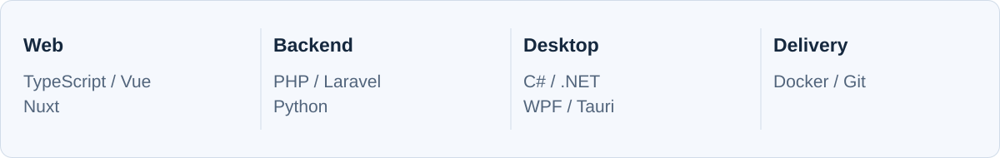

  <picture>
    <source media="(prefers-reduced-motion: reduce)" srcset="./assets/orbital-banner.png" />
    
  </picture>

  <a href="https://github.com/sajadjanat?tab=repositories">Explore my repositories</a> &nbsp; / &nbsp;
  <a href="https://www.linkedin.com/in/sajadjanat/">LinkedIn</a> &nbsp; / &nbsp;
  <a href="https://sepehra.ir">Sepehra</a>

## Complex problems. Useful products.

I'm **Sajad**, a software engineer and systems thinker based in Mashhad, Iran.
I build across web, desktop, and developer tooling — connecting thoughtful architecture with things people can actually use.

I care about the whole journey: understanding the problem, shaping the experience, and making the system work.

  <picture>
    <source media="(prefers-reduced-motion: reduce)" srcset="./assets/project-orbits.svg" />
    
  </picture>

## A few things I've put into orbit

<table>
<tr>
<td width="50%" valign="top">
<a href="https://github.com/sajadjanat/gitorbit"><picture>
  <source media="(prefers-color-scheme: dark)" srcset="./assets/card-gitorbit-dark.svg" />
  
</picture></a>
</td>
<td width="50%" valign="top">
<a href="https://github.com/sajadjanat/taskorbit"><picture>
  <source media="(prefers-color-scheme: dark)" srcset="./assets/card-taskorbit-dark.svg" />
  
</picture></a>
</td>
</tr>
<tr>
<td width="50%" valign="top">
<a href="https://github.com/sajadjanat/hotfi"><picture>
  <source media="(prefers-color-scheme: dark)" srcset="./assets/card-hotfi-dark.svg" />
  
</picture></a>
</td>
<td width="50%" valign="top">
<a href="https://github.com/sajadjanat/vue-neshan-maps"><picture>
  <source media="(prefers-color-scheme: dark)" srcset="./assets/card-vue-neshan-maps-dark.svg" />
  
</picture></a>
</td>
</tr>
</table>

<a href="https://sajadjanat.github.io/vue-neshan-maps/">Try the maps demo</a> &nbsp; / &nbsp; <a href="https://github.com/sajadjanat?tab=repositories">All repositories</a>

### Smaller tools. Real problems.

- [**iran-market-skills**](https://github.com/sajadjanat/iran-market-skills) — Evidence-led Codex skills for Iranian market research and Persian digital products.
- [**laravel-mattermost-bot-logger**](https://github.com/sajadjanat/laravel-mattermost-bot-logger) — Send Laravel logs and exceptions to Mattermost through a dedicated logging channel.

## How I build

**Start with the problem. Think in systems. Pay attention to the experience.**

My public work spans **TypeScript, Vue, Nuxt, PHP, Laravel, C#, .NET, Python, and Docker** — from developer workflows to desktop utilities and tools for Persian-speaking teams.

<picture>
  <source media="(prefers-color-scheme: dark)" srcset="./assets/toolbox-dark.svg" />
  
</picture>

---

  Have a complex problem worth building for? 
  <a href="https://www.linkedin.com/in/sajadjanat/"><strong>Let's talk on LinkedIn</strong></a> &nbsp; · &nbsp; <a href="https://sepehra.ir">Find me at Sepehra</a>

